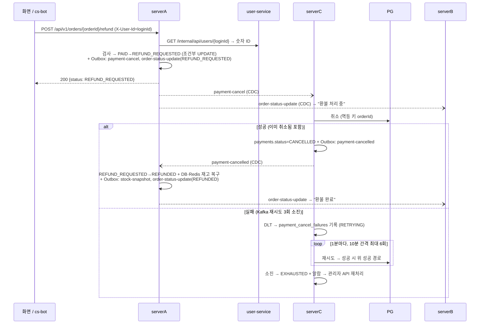

# 사용자 환불 + 환불 실패 재처리

- 요구사항 확인 ☑
- 설계 확인 ☑
- 작업 항목: BL-029

## 1. 요구사항

### 정책
| ID | 정책 |
|----|------|
| P-1 | 환불 요청은 serverA 환불 API 한 곳에서 받는다. 주문 상세 화면과 cs-bot 모두 이 API를 쓴다 (cs-bot의 `payment-cancel` 직접 발행은 없앤다) |
| P-2 | 본인 주문만 환불할 수 있다. 다른 사람의 주문은 "주문 없음"과 같게 응답한다 |
| P-3 | 환불 가능 조건: 주문 상태가 결제 완료(PAID)이고, 결제 완료 시각부터 7일 이내. 7일은 설정값이다. 상품 상태(미개봉 등)는 검사하지 않는다 |
| P-4 | 주문 전체 환불만 한다 (부분 환불 없음) |
| P-5 | 환불이 완료되면 재고(DB·Redis)를 주문 수량만큼 되돌린다 |
| P-6 | 이미 환불 접수·처리 중·완료된 주문에 다시 요청하면 새로 처리하지 않고, 성공 응답에 현재 환불 상태를 담아 돌려준다 (멱등). PG 환불은 주문당 한 번만 일어난다 |
| P-7 | PG 환불이 실패하면 실패로 기록하고 자동으로 재시도한다. 자동 재시도 횟수(설정값)를 다 쓰면 알람을 보내고, 그 뒤에는 관리자가 API로 재처리한다. 재시도해도 이중 환불은 생기지 않는다 |
| P-8 | 환불이 실패해 재처리를 기다리는 동안에도 사용자에게는 "환불 처리 중"으로 보인다. 실패는 내부 상태로만 둔다 |
| P-9 | 실패 기록·자동 재시도·관리자 재처리는 Saga 보상 망취소(결제는 됐지만 주문이 FAILED/EXPIRED라 취소하는 경우)에도 똑같이 적용한다. 주문의 환불 상태 변경과 재고 복구는 사용자 환불에만 한다 (망취소 주문은 이미 FAILED/EXPIRED이고 재고도 Saga가 복구함) |
| P-10 | 관리자 기능(PG 취소 실패 목록 조회, 재처리)은 ROLE_ADMIN 전용 API로만 제공한다. 화면은 만들지 않는다 |
| P-11 | cs-bot FAQ(`refund-policy.yaml`)를 이 정책에 맞춘다: "결제 후 7일 이내, 주문 전체 환불만". 선착순 3일·부분 환불 안내는 지운다 |
| P-12 | 환불해도 1인 1회 구매 표시는 풀지 않는다. 환불한 사용자는 같은 상품을 다시 살 수 없다 (재고만 복구) |

### 시나리오
| ID | 구분 | 상황 | 동작 | 결과 |
|----|------|------|------|------|
| S-1 | 정상 | 본인 주문 PAID, 결제 완료 후 7일 이내 | 주문 상세에서 환불 요청 | 접수 → "환불 처리 중" → PG 취소 성공 → "환불 완료", 재고 복구 |
| S-2 | 정상 | S-1과 같은 주문 | cs-bot에 환불 요청 | S-1과 같은 API·정책으로 처리, 챗봇이 접수 결과를 안내 |
| S-3 | 예외 | 결제 완료 후 7일이 지남 | 환불 요청 | 거절, "환불 기간(결제 후 7일)이 지났습니다" |
| S-4 | 예외 | 주문이 PAID가 아님 (PENDING·FAILED·EXPIRED) | 환불 요청 | 거절, "환불할 수 없는 주문 상태입니다" |
| S-5 | 예외 | 다른 사람의 주문 또는 없는 주문 | 환불 요청 | 거절, "주문을 찾을 수 없습니다" (둘을 구분하지 않음) |
| S-6 | 동시성 | 이미 환불 접수·처리 중·완료된 주문 (더블클릭, 챗봇 재요청 포함) | 환불 요청 | 성공 응답 + 현재 환불 상태. PG 취소는 추가로 일어나지 않음 |
| S-7 | 예외 | PG 취소가 실패 (재시도 소진) | — | 실패로 기록, 사용자에게는 "환불 처리 중" 유지, 자동 재시도 예약 |
| S-8 | 예외 | 자동 재시도가 성공 | — | "환불 완료", 재고 복구 (S-1과 같은 결과) |
| S-9 | 운영 | 자동 재시도 횟수를 다 씀 | — | 알람 발송, 관리자 재처리 대기 |
| S-10 | 운영 | 관리자가 실패 목록 조회 후 재처리 | 관리자 API 호출 | PG 취소 재실행 → 성공 시 S-8과 같은 결과, 실패 시 실패 상태 유지 |
| S-11 | 예외 | Saga 보상 망취소의 PG 취소가 실패 | — | S-7·S-9·S-10과 같은 실패 기록·재시도·재처리. 주문 상태는 FAILED/EXPIRED 그대로, 재고 복구 없음 |
| S-12 | 동시성 | 재시도 직전에 앞선 PG 취소가 실제로는 성공해 있었음 (응답만 유실) | 재시도 실행 | 이중 환불 없이 "환불 완료"로 정리 |

### 화면
주문 상세(주문 상태 조회) 화면:
- PAID: "환불 요청" 버튼과 로그인 ID 입력칸을 보여준다 (프론트에 로그인이 없어 구매 화면처럼 직접 입력). 누르면 확인을 한 번 받고 요청한다.
- 환불 접수 후: 상태를 "환불 처리 중"으로 표시 (PG 실패·재시도 중에도 같음).
- 환불 완료: 상태를 "환불 완료"로 표시.
- 거절(S-3·S-4·S-5): 위 시나리오의 문구를 보여준다. 기간이 지난 주문도 버튼은 보이고, 누르면 S-3 문구로 거절된다 (화면은 결제 완료 시각을 모른다).

cs-bot: 환불 접수·거절 결과를 위 문구와 같은 뜻으로 안내한다. 환불 상태 조회는 "환불 처리 중 / 환불 완료"로 답한다.

### 완료 기준
- [ ] PAID·7일 이내 본인 주문에 환불을 요청하면 PG 취소가 한 번 일어나고, 주문이 "환불 완료"가 되며 재고가 주문 수량만큼 늘어난다 (S-1)
- [ ] cs-bot 환불 요청이 serverA 환불 API를 거치고, cs-bot에서 `payment-cancel`을 직접 발행하는 코드가 없다 (S-2)
- [ ] 7일 초과·PAID 아님·남의 주문/없는 주문은 각각 정해진 응답으로 거절되고 PG 취소가 일어나지 않는다 (S-3, S-4, S-5)
- [ ] 같은 주문에 환불 요청을 동시에 두 번 보내도 PG 취소는 한 번이고, 두 응답 모두 성공이다 (S-6)
- [ ] PG 취소가 실패하면 실패 기록이 남고, 사용자 조회는 "환불 처리 중"이며, 자동 재시도로 성공하면 "환불 완료" + 재고 복구가 된다 (S-7, S-8)
- [ ] 자동 재시도를 다 쓰면 알람이 발생하고, 관리자 API로 목록 조회·재처리가 된다. 일반 사용자는 관리자 API를 호출할 수 없다 (S-9, S-10)
- [ ] Saga 망취소 실패도 같은 실패 목록에 나오고 재처리되며, 주문 상태와 재고는 바뀌지 않는다 (S-11)
- [ ] PG에서 이미 취소된 거래를 재시도해도 이중 환불이 되지 않고 완료로 정리된다 (S-12)
- [ ] cs-bot FAQ가 "결제 후 7일, 주문 전체 환불만"으로 안내한다 (P-11)
- [ ] 환불이 끝난 사용자가 같은 상품을 다시 구매하면 거절된다 (P-12)

### 범위 밖
- 부분 환불(수량 일부): PG 부분취소 API와 누적 환불액 관리가 필요하다. 필요해지면 새 백로그 항목으로.
- 상품 상태(미개봉·반품 회수) 검사: 배송·반품 도메인이 없다.
- 상품 유형별 환불 기간(선착순 한정 3일 등): 상품에 유형 구분이 없다. 기간은 설정값 하나로 둔다.
- 관리자 화면: API만 제공한다.
- 환불 요청 철회(접수 후 사용자가 취소): 지원하지 않는다.
- PG 거래 내역과의 대사: BL-002.

## 2. 결정 기록
| 질문 | 결정 | 이유 |
|------|------|------|
| 환불 요청을 어디서 받나 | serverA API로 모으고 화면·cs-bot이 이 API를 쓴다 | 주문 상태·정책 검사를 한 곳에서 한다. 지금은 cs-bot 직접 발행이라 serverA 주문이 PAID로 남는다 |
| 환불 가능 조건 | PAID + 기간만 검사 | 미개봉 여부를 판단할 배송·반품 데이터가 없다 |
| 환불 기간 | 결제 완료 후 7일, 설정값 | FAQ 일반 기준. 결제 완료 시각이 없으면 따로 저장한다 (설계에서 확정). 법적 기준(전자상거래법 청약철회 7일)과의 관계는 **확인 필요** |
| 부분 환불 | 하지 않음, 주문 전체만 | 주문이 상품 1종이라 부분 환불은 수량 일부뿐이고, PG 부분취소·누적 환불액 관리 비용이 크다 |
| 재고 복구 | 환불 완료 시 DB·Redis 복구 | 선착순 상품을 다시 판매할 수 있게 한다. Saga 실패 보상과 같은 방식 |
| 환불 실패 재처리 | 자동 재시도(횟수 설정) → 소진 시 알람 → 관리자 API 재처리 | 일시 장애는 사람 없이 복구하고, 계속 실패하면 사람이 본다 |
| 실패 중 사용자 표시 | "환불 처리 중" 유지 | 사용자가 할 수 있는 일이 없다. 운영이 해결한다 |
| 관리자 기능 형태 | ROLE_ADMIN API만 | 규모를 줄인다. 화면은 범위 밖 |
| FAQ 불일치 | FAQ를 정책에 맞춘다 | 챗봇이 실제와 다른 안내를 하지 않게 한다 |
| 중복 환불 요청 | 성공 + 현재 상태 반환 (멱등) | 더블클릭·챗봇 재요청이 에러로 보이지 않게 하고, PG 환불은 한 번만 일어나게 한다 |
| 망취소 실패도 포함하나 | 포함. 주문 상태·재고 변경은 사용자 환불에만 | 망취소 실패도 고객 돈이 나간 채 방치되는 건 같다. 같은 토픽·컨슈머를 쓴다 |
| 프론트 사용자 식별 | 로그인 ID를 입력받아 `X-User-Id` 헤더로 보낸다. 프론트 로그인은 범위 밖 | 프론트에 로그인이 없다. 구매 화면과 같은 수준(로컬 데모)이고 위조할 수 있다 |
| 환불 API 경로 | `POST /api/v1/orders/{orderId}/refund` + 게이트웨이에 serverA 라우트 추가 | 주문 아래 경로가 REST에 맞다. 지금은 `/api/v1/orders/**`가 모두 serverB로 간다 |
| 본인 확인 방식 | `X-User-Id`(loginId)를 serverA가 user-service 내부 API로 숫자 ID로 바꿔 `orders.user_id`와 비교 | 환불은 돈이 나가는 요청이라 JWT와 연결한다. cs-bot과 같은 방식. 대안(숫자 userId를 요청에 담기)은 주문번호와 userId만 알면 남의 주문을 환불할 수 있다 |
| 환불 후 재구매 | 불가 (구매 표시 유지) | 구매→환불→재구매로 선착순 재고를 잡아 두는 악용을 막는다 |
| 기간 지난 주문의 화면 | 버튼은 보이고 API 거절 문구로 안내 | 화면 데이터(serverB)에 결제 완료 시각이 없다. 이벤트·serverB를 바꾸지 않는다 |
| 프론트 P0 여부 | P0 아님 | 단위 테스트(Vitest+RTL)만. 환불 흐름은 백엔드 E2E로 검증한다 |
| 자동 재시도 기본값 | 10분 간격, 최대 6회 (설정값) | 약 1시간 동안 일시 장애를 사람 없이 흡수하고, 그 뒤엔 알람으로 넘긴다 |
| P0 알람 기준 | `refund_fatal` → 자동 재시도 소진 메트릭 | 자동 재시도에 들어간 것만으로는 수기 정산이 아니다. 그대로 두면 P0 오탐이 난다 |
| serverA admin API 역할 검사 누락 | 이번 범위 밖, BL-030 | 환불과 무관하고, 고치면 cs-bot 내부 호출도 바꿔야 한다 |

## 3. 설계

### 흐름


### DB 변경
**serverA (Flyway V4)**
- `orders.paid_at DATETIME NULL` 추가. `markAsPaid`(Saga 완료·결제조회 보정 모두)에서 기록한다.
- 기존 PAID 주문은 `paid_at = updated_at`으로 채운다 (PAID 이후 상태 변경이 없어 `updated_at`이 결제 확정 시각). 새 코드는 `paid_at`이 NULL인 경우를 다루지 않는다.
- `orders.status`는 VARCHAR라 값만 늘어난다: `REFUND_REQUESTED`, `REFUNDED`.

| 현재 | 트리거 | 다음 |
|------|--------|------|
| PAID | 환불 API (조건 충족) | REFUND_REQUESTED |
| REFUND_REQUESTED | `payment-cancelled` 수신 | REFUNDED (+ 재고 복구) |
| REFUND_REQUESTED·REFUNDED | 환불 API 재요청 | 변화 없음 (현재 상태 응답) |

**serverC (Flyway V3)**
- `payments.status`에 `CANCELLED`는 이미 쓰고 있다. 새 값 없음. PG 취소가 실패하는 동안 `payments.status`는 PAID로 둔다 (실패는 아래 테이블에만).
- 새 테이블 `payment_cancel_failures`:

| 컬럼 | 타입 | 설명 |
|------|------|------|
| id | BIGINT PK AUTO_INCREMENT | |
| order_id | VARCHAR UNIQUE NOT NULL | 주문당 한 행 (실패가 반복돼도 같은 행 갱신) |
| status | VARCHAR(20) NOT NULL | RETRYING / EXHAUSTED / RESOLVED |
| attempts | INT NOT NULL | 자동·수동 재시도 횟수 |
| next_retry_at | DATETIME NULL | 다음 자동 재시도 시각 (EXHAUSTED·RESOLVED면 NULL) |
| last_error | VARCHAR(500) | 마지막 실패 사유 |
| created_at / updated_at | DATETIME | |

인덱스: `(status, next_retry_at)` — 스케줄러 조회용.

| 현재 | 트리거 | 다음 |
|------|--------|------|
| (없음) | payment-cancel DLT 도착 | RETRYING (attempts=0, next_retry_at=지금+10분) |
| RETRYING | 자동 재시도 실패, attempts < 6 | RETRYING (attempts+1, next_retry_at=지금+10분) |
| RETRYING | 자동 재시도 실패, attempts = 6 | EXHAUSTED + 알람 |
| RETRYING·EXHAUSTED | 재시도 성공 (자동·관리자) | RESOLVED |
| EXHAUSTED | 관리자 재처리 실패 | EXHAUSTED (attempts+1) |
| RESOLVED | DLT 재도착 (예: 재대사 스케줄러가 다시 보낸 망취소가 또 실패) | RETRYING (attempts 유지) |

재시도 간격 10분·최대 6회(약 1시간)는 설정값이다.

### API
**serverA — 환불 요청** (`contracts/server-a-openapi.yaml`에 구현 PR에서 추가)
```yaml
  /api/v1/orders/{orderId}/refund:
    post:
      operationId: requestRefund
      summary: 주문 환불 요청 (주문 전체)
      parameters:
        - name: orderId
          in: path
          required: true
          schema: { type: string }
        - name: X-User-Id
          in: header
          required: true
          description: 로그인 ID. 운영에서는 게이트웨이가 JWT를 검증해 넣는다
          schema: { type: string }
      responses:
        '200':
          description: 환불 접수됨 또는 이미 접수·완료됨 (멱등)
          content:
            application/json:
              schema: { $ref: '#/components/schemas/RefundResponse' }
        '401': { description: X-User-Id 없음 }
        '404': { description: "ORDER_NOT_FOUND — 주문이 없거나 본인 주문이 아님", content: { application/json: { schema: { $ref: '#/components/schemas/ErrorResponse' } } } }
        '409': { description: "REFUND_NOT_ALLOWED_STATUS(PAID 아님) / REFUND_PERIOD_EXPIRED(결제 후 7일 초과)", content: { application/json: { schema: { $ref: '#/components/schemas/ErrorResponse' } } } }
        '503': { description: "USER_LOOKUP_UNAVAILABLE — user-service 조회 실패", content: { application/json: { schema: { $ref: '#/components/schemas/ErrorResponse' } } } }
components:
  schemas:
    RefundResponse:
      type: object
      required: [orderId, status]
      properties:
        orderId: { type: string }
        status: { type: string, enum: [REFUND_REQUESTED, REFUNDED] }
```
- 에러 본문은 기존 `ErrorResponse(status, error, message)`. `error`에 위 코드를, `message`에 요구사항의 화면 문구를 담는다.
- user-service에 loginId가 없으면 404 ORDER_NOT_FOUND로 응답한다 (S-5와 같은 응답).
- 게이트웨이: `serverA-refund` 라우트(`Path=/api/v1/orders/*/refund`, `Method=POST` → serverA)를 `serverB-orders`보다 앞에 둔다. `application.yml`·`application-k8s.yml` 둘 다. Rate limit은 serverA 기본값(초당 20, 버스트 50).
- serverA → user-service: 새 동기 호출 (`PaymentQueryClient`처럼 connect 3s / read 5s, DiscoveryClient). K8s는 `application-k8s.yml`의 SimpleDiscoveryClient에 user-service를 등록한다.

**serverB — 주문 상태 조회** (`contracts/openapi.yaml`)
- `OrderStatusResponse.status` enum에 `REFUND_REQUESTED`, `REFUNDED` 추가. serverB 로직 변경 없음 (상태 문자열을 그대로 저장·응답하고, 결과 회신은 PENDING일 때만 한다).

**serverC — 관리자 API** (serverC는 계약 파일이 없다. 기존 `/api/v1/payments/**` 게이트웨이 라우트를 그대로 쓴다)
```yaml
  /api/v1/payments/admin/cancel-failures:
    get:
      summary: PG 취소 실패 목록
      parameters:
        - { name: X-User-Role, in: header, required: true, schema: { type: string } }   # ROLE_ADMIN 아니면 403
        - { name: status, in: query, schema: { type: string, enum: [RETRYING, EXHAUSTED], default: EXHAUSTED } }
      responses:
        '200': { description: "[{orderId, status, attempts, nextRetryAt, lastError, createdAt, updatedAt}]" }
        '403': { description: 관리자 아님 }
  /api/v1/payments/admin/cancel-failures/{orderId}/retry:
    post:
      summary: PG 취소 즉시 재처리 (동기 1회)
      parameters:
        - { name: X-User-Role, in: header, required: true, schema: { type: string } }
        - { name: orderId, in: path, required: true, schema: { type: string } }
      responses:
        '200': { description: "{orderId, status: RESOLVED | EXHAUSTED | RETRYING, lastError} — 이미 RESOLVED면 그대로 응답" }
        '403': { description: 관리자 아님 }
        '404': { description: 실패 기록 없음 }
```
- 관리자 판정은 게이트웨이가 넣는 `X-User-Role == ROLE_ADMIN`. 클러스터 안에서 serverC를 직접 부르면 헤더를 위조할 수 있다 — 외부 노출은 게이트웨이뿐이라는 전제 (기존 serverA `/api/v1/admin`도 같은 전제이고, 거기는 역할 검사 자체가 없다 → 발견 사항).

### 이벤트
| 토픽 | 변경 | 발행 | 소비 | 메시지 | 멱등 |
|------|------|------|------|--------|------|
| `payment-cancel` | 발행자 변경: cs-bot 직접 발행 제거, serverA 환불이 추가 (Outbox) | serverA (Saga 보상·재대사·**환불**) | serverC `PaymentCancelConsumer` | 변경 없음 `{orderId}` | serverC: 이미 CANCELLED면 PG 호출 없이 `payment-cancelled`만 다시 발행. PG 취소 자체도 orderId 멱등 |
| `payment-cancelled` | **새 토픽** (파티션 3, DLT `payment-cancelled.DLT`) | serverC (Outbox, `payments.status=CANCELLED`와 같은 트랜잭션) | serverA 새 컨슈머 | `{orderId, cancelledAt}`, key=orderId | serverA: `UPDATE ... SET status='REFUNDED' WHERE order_id=? AND status='REFUND_REQUESTED'` 결과가 1행일 때만 재고 복구. 0행이면(망취소·중복) 무시 |
| `order-status-update` | status 값 추가: `REFUND_REQUESTED`, `REFUNDED` | serverA | serverB | 필드 변경 없음 | 기존과 같음 (덮어쓰기) |

- `payment-cancelled`는 망취소를 포함한 모든 PG 취소 성공에 발행한다. 사용자 환불인지는 serverA가 주문 상태(REFUND_REQUESTED)로 판단하므로 메시지에 구분 필드를 두지 않는다.
- 배포 순서: serverB(enum 추가) → serverA(새 컨슈머·API, 소비자 먼저) → serverC → 게이트웨이 → cs-bot → frontend. serverC가 먼저 나가도 그 시점엔 REFUND_REQUESTED 주문이 없어 유실돼도 무해하다.
- serverC Outbox의 새 토픽이 Debezium 라우팅에 걸리는지 구현 때 확인한다 (`payment-result`와 같은 경로).

### 장애 시 동작
| 실패 지점 | 동작 |
|------|------|
| user-service 조회 실패 | 503, 아무것도 바뀌지 않음. 사용자가 다시 요청 |
| serverA 트랜잭션 실패 | 500, 상태 변경·Outbox 모두 롤백 |
| 같은 주문 동시 요청 | 조건부 UPDATE(`WHERE status='PAID'`)로 한 요청만 성공. 진 요청은 다시 읽어 현재 상태로 200 (S-6) |
| CDC·Kafka 지연 | 주문은 REFUND_REQUESTED("환불 처리 중")로 남았다가 전달되면 진행 |
| PG 취소 실패 | Kafka 재시도 3회(지수 백오프, 기존 설정) → DLT → `payment_cancel_failures` RETRYING → 스케줄러 재시도 (S-7) |
| PG 취소 응답 유실 (실제로는 취소됨) | 재시도 시 PG가 "이미 취소됨"을 돌려주고 성공으로 처리. 이중 환불 없음 (S-12) |
| PG 취소 성공 후 serverC DB 갱신 실패 | 예외 → Kafka 재시도 → PG "이미 취소됨" → 성공 경로 |
| `payment-cancel` 도착 시 결제가 이미 CANCELLED | PG 호출 없이 `payment-cancelled`만 다시 발행. 옛 cs-bot 경로로 취소된 주문을 환불 요청해도 REFUND_REQUESTED에 갇히지 않는다 |
| `payment-cancel` 도착 시 결제가 없거나 PAID·CANCELLED가 아님 | PG를 호출하지 않고 `payment_cancel_failures`에 EXHAUSTED로 기록(사유 포함) + 알람 → 관리자 확인 |
| 자동 재시도 6회 소진 | EXHAUSTED + `business_payment_cancel_retry_exhausted_total` 증가 → Prometheus 알람 (S-9) |
| serverC 여러 인스턴스가 같은 행 재시도 | 조회 후 조건부 UPDATE로 `next_retry_at`을 미뤄 행을 선점한 인스턴스만 실행. 새 의존성(ShedLock) 없음. 겹치더라도 PG 멱등으로 안전 |
| 관리자 재처리와 자동 재시도가 겹침 | 위와 같음 — PG 멱등이 최종 안전장치 |
| 망취소가 실패 중일 때 serverA 재대사(`reconcileTerminatedOrders`)가 `payment-cancel`을 다시 보냄 | serverC는 PAID라 PG 취소를 다시 시도한다. 실패하면 DLT → 기존 행 갱신(attempts 유지). 재시도 경로가 둘이지만 PG 멱등으로 안전 |
| serverA `payment-cancelled` 처리 실패 | Kafka 재시도 → DLT `payment-cancelled.DLT` (로그 + 메트릭). 주문은 REFUND_REQUESTED에 남음 → 관리자 확인 |
| Redis 재고 복구 실패 | Saga 보상과 같은 방식(같은 트랜잭션 안에서 DB 재고 증가 + Redis 복구 + `stock-snapshot` Outbox)을 따른다 |

### 기존 코드에 미치는 영향
- serverA `markAsPaid`가 `paid_at`을 기록한다. 재대사 스케줄러들은 PENDING·EXPIRED·FAILED만 보므로 새 상태의 영향을 받지 않는다.
- serverC `PgClient.cancelPayments(List)` → orderId 단위의 멱등 취소로 바꾼다 (성공 / 이미 취소됨 / 실패 구분). `MockPgClient`는 취소 상태를 기억하고, 테스트에서 취소 실패를 재현할 수단을 둔다 (방법은 구현 때). 실제 PG 연동 시 취소 API가 멱등 키를 지원하는지 **확인 필요**.
- serverC DLT 핸들러: 메트릭·로그만 → `payment_cancel_failures` 기록. 기존 `business_payment_pg_refund_fatal_total`은 "자동 재시도 진입" 건수로 의미가 바뀐다.
- 알람: P0 `PaymentFatalError`(`monitoring/prometheus/alert-rules.yml`, `helm/promotion-monitoring/files/alert-rules.yml`)가 지금은 `refund_fatal`에 걸려 있다 → `business_payment_cancel_retry_exhausted_total`로 바꾼다 (자동 재시도 진입은 아직 수기 정산이 아니다). P2 `FallbackSuccessRateDrop`(첫 시도 성공률)과 Grafana 패널은 의미가 맞아 그대로 둔다.
- cs-bot: `requestRefund` → serverA 환불 API 호출(`X-User-Id`=loginId). `trackRefundStatus` → serverB 주문 상태(REFUND_REQUESTED=처리 중, REFUNDED=완료). `payment-cancel` 직접 발행 코드 제거.

### 프론트 영향
- 주문 상태 조회 화면(`frontend/src/app/orders/[orderId]/page.tsx`): 상태 문구(REFUND_REQUESTED → "환불 처리 중", REFUNDED → "환불 완료"), PAID일 때 로그인 ID 입력 + 환불 버튼 + 확인 + 거절 문구. serverA 클라이언트(`clientA`)로 호출.
- P0 아님 → Vitest+RTL 단위 테스트.

### 새 기술
없음. 새 Gradle 의존성 없음 (스케줄러 선점은 조건부 UPDATE, user-service 호출은 기존 RestClient).

## 4. 변경 이력 (확인 이후)
| 날짜 | 변경 | 이유 |
|------|------|------|
| 2026-11-14 | 화면: 기간이 지난 주문에 "버튼 대신 안내 문구" → "버튼은 보이고 누르면 거절 문구". PAID 화면에 로그인 ID 입력칸 추가 | 설계 중 발견: 화면 데이터(serverB)에 결제 완료 시각이 없고, 프론트에 로그인이 없다 |
| 2026-11-14 | P-12 추가: 환불 후 재구매 불가 | 설계 중 발견: Saga 보상은 1인 1회 구매 표시도 푸는데, 환불에서의 처리가 정해져 있지 않았다 |
